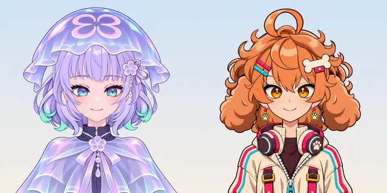
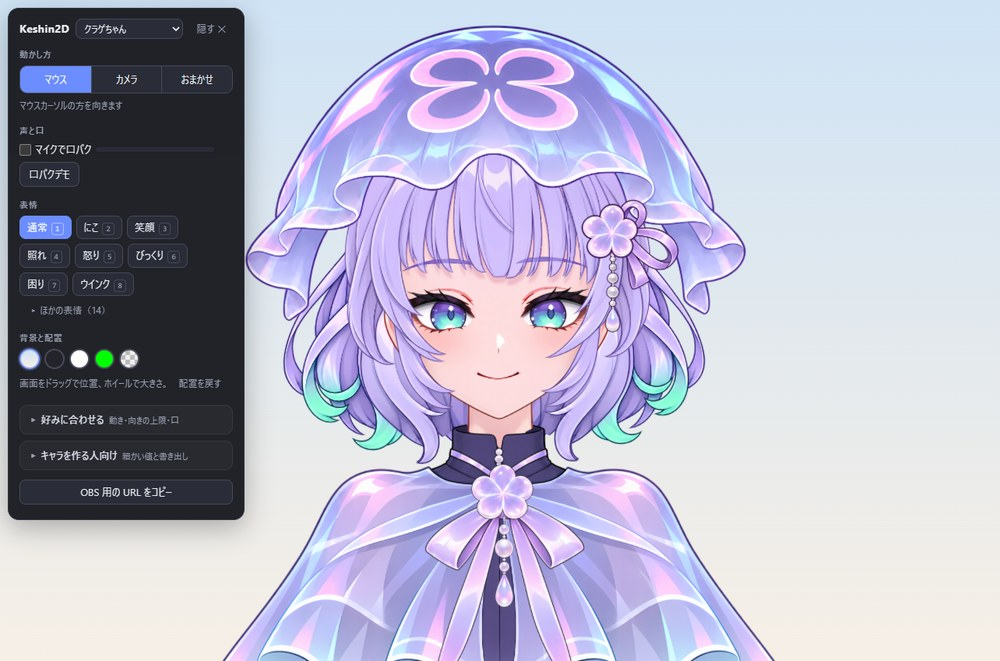
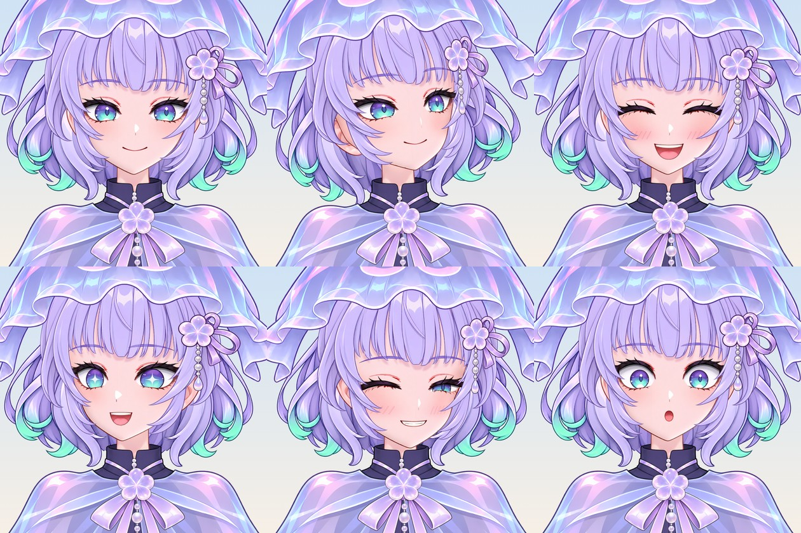
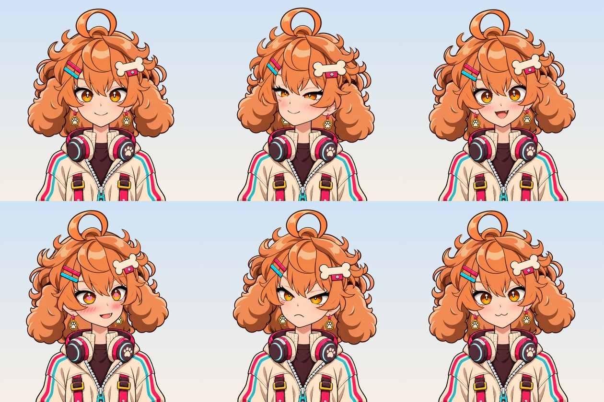
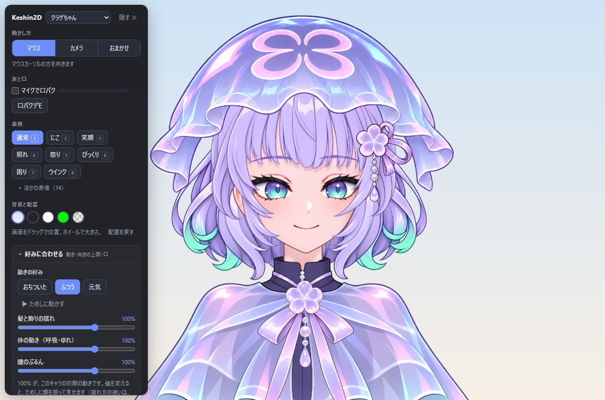

# Keshin2D

<p align="center"><a href="README.md">日本語</a> | <strong>English</strong></p>

<p align="center"><strong>A 2D avatar that runs in your browser, with tools to build your own model from one character picture.</strong></p>

<p align="center">
  <a href="https://github.com/rotejin/Keshin2D/actions/workflows/ci.yml"></a>
  
  
  
  <a href="https://github.com/sponsors/rotejin"></a>
  <a href="https://x.com/rotejin"></a>
</p>

<p align="center">
  
</p>

Keshin2D ("keshin", 化身, is the Japanese word for avatar) deforms a character's layered artwork with WebGL2 meshes every frame: head turn, gaze, blinks, expressions, mouth shapes, and hair and accessory physics. No dedicated modeling software is needed. All you need to run it is Python and a browser.

Two models are bundled. One of them, chiwa, was built end to end from a single character picture with the tools and the workflow in this repository.

**▶ Try it in the browser: <https://rotejin.github.io/Keshin2D/>** (no install; switch between the two models with the selector at the top of the panel)

The control panel and the character-building documents are in Japanese. This page explains what the controls do.

## What you need

- **Python 3.8 or later** (standard library only, nothing to install; tested with 3.10 and 3.12)
- **A browser with WebGL2** (tested with Google Chrome and Microsoft Edge; Firefox and Safari are not tested)
- **Operating system**: made and tested by hand on Windows. **On macOS and Linux it is checked on GitHub Actions machines (headless Chrome, no GPU): starting with `start.sh`, rendering and the control checks pass there.** It has not yet been tried by a person on a real Mac or Linux desktop

To build your own character you also need the following (details in [partsgen/README.md](partsgen/README.md), Japanese):

- Python 3.10 or later (`numpy`, `opencv-python`, `pillow`) and Node.js 22 or later
- **A Codex CLI that can generate images** (OpenAI; needs an OpenAI plan. Tested with the one that comes with the Codex app for Windows)
- Real-ESRGAN for upscaling (needs a Vulkan-capable GPU; not bundled, but one setup command fetches it from its publisher. See [partsgen/UPSCALER.md](partsgen/UPSCALER.md))
- An AI coding agent such as Claude Code, which carries out the work

## Try a bundled model first

Get the files with **Code → Download ZIP** on this page and extract them, or `git clone` the repository. Then start it from that folder:

| OS | How to start |
|---|---|
| Windows | Double-click `start.bat` |
| macOS, Linux | Run `./start.sh` in a terminal (or `sh start.sh` if it is not executable; a ZIP download can drop the permission) |
| Any | `python tools/serve.py` (`python3` on some systems) |

A browser opens and shows kurage02. Google Chrome is used if it is installed, otherwise your default browser.
The window that opened (the black console) is a small local server. To stop it, press Ctrl+C in that window or close it.

- **Switching models**: use the selector at the top of the panel. To open chiwa first, run `start.bat --model chiwa` (`./start.sh --model chiwa`).
- Port 8770 is used. If it is taken, the next free port is used (up to 20 ports higher). You can also pass `--port N`.
- Opening `index.html` by double-clicking it does not work, because browsers block loading from local files. Always start it as described above.



## What it does

- **Three ways to drive it**: the mouse (the character looks at the pointer), a webcam (follows your face) and a scripted idle act
- **22 expressions** and microphone lip sync (the mouth shape follows the vowel you say)
- **Hair and accessory physics** (hair locks, ribbons, earrings, an ahoge and so on), with adjustable strength
- A transparent output for an **OBS** browser source
- **A new character from one picture**, using image generation and the bundled tools ([Make your own character](#make-your-own-character))
- Webcam frames and microphone audio are processed inside the browser only. Nothing is uploaded

## Bundled models

| kurage02 (クラゲちゃん) | chiwa (チワちゃん) |
| --- | --- |
|  |  |
| Opens first. The jellyfish hat, the hair ornament and the chest ribbon swing | The ahoge and the earrings swing |
| `models/kurage02/` | `models/chiwa/` |

`partsgen/chars/` holds each model's settings (`char.json`), the prompts given to the image generator (`prompts/`) and the notes from building or reviewing it (`NOTES.md`, Japanese).

The tools and the workflow were also fixed along the way while chiwa was being built (notes: [partsgen/chars/chiwa/NOTES.md](partsgen/chars/chiwa/NOTES.md)).

Both bundled models are under the same MIT License as the code ([License](#license)).

## Controls

The panel on the left has three levels. For everyday use you only need the top one.

**The everyday screen**

| Control (label in the panel) | What it does |
|---|---|
| Model selector (top) | Switches models: the two bundled ones and any you made |
| 動かし方 (drive mode) | マウス = follow the mouse, カメラ = follow your face with a webcam, おまかせ = repeat a scripted act of about 14 seconds. Pressing マウス also resets the expression |
| マイクで口パク (mic lip sync) | Moves the mouth with your voice; the shape follows the vowel. The bar on the right shows the volume |
| 口パクデモ (lip sync demo) | Shows a talking mouth without sound |
| 表情 (expressions) | 22 including neutral. The 8 most used are on top and on the number keys 1–8; the rest are under ほかの表情 |
| 背景 (background) | Light, dark, white, green (chroma key) or transparent |
| Placement | Drag to move, scroll to resize, double-click to reset |
| 隠す (hide) | Hides the panel (the H key toggles it). Move the mouse to get the ☰ button at the top left back |

**好みに合わせる (tune to taste)**, opened by clicking it



| Item | What it does |
|---|---|
| 動きの好み (motion) | Hair and accessory sway, body motion (breathing and sway) and the eye bounce, as a percentage of the model's default. おちついた / ふつう / 元気 (calm / normal / lively) set all three at once. Changing a value makes the head shake once to show the result |
| 飾りごとに決める (per accessory) | Sets each accessory of the model (ribbons, chains, earrings and so on) separately. The list depends on the model |
| 向きの上限 (turn limits) | The nine direction buttons hold the head at the limit in that direction, so you can adjust the left/right, up, down and tilt limits while looking at it |
| マイクの口パク (mic lip sync) | Mouth size, noise gate and voice pitch. If the mouth shapes do not match your voice, use 声を覚えさせる (teach your voice), which walks you through the five vowels |
| 母音の口の大きさ (vowel shapes) | Pressing a vowel holds that mouth shape, so you can set its opening, width and height |

**キャラを作る人向け (for model authors)** holds the detailed values used to set a model's defaults. You do not need to open it for everyday use.

Tuning values and the placement are saved in the browser (per model; a different port number is a separate store). 好みを全部もとに戻す (reset all) restores the model's defaults.

### Using it with OBS

Press **OBS 用の URL をコピー** (copy URL for OBS) at the bottom of the panel to get a URL that carries the current placement, drive mode and tuning values. Paste it into the URL of an OBS Browser source, and keep the server running.
Tuning values live only in your browser, and OBS has its own storage, so they are passed in this URL. Copy and paste it again after you change the tuning.

The shortest URL you can write by hand is (`model=` is the model name):

```text
http://127.0.0.1:8770/index.html?model=kurage02&ui=0&bg=transparent
```

`ui=0` hides the panel and `bg=transparent` makes the background transparent. Set the width and height to suit your scene.

**It has not been tested inside OBS yet**, including whether mouse following, the webcam and the microphone work inside an OBS browser source.
If it does not work, you can open it in a normal browser with `bg=green`, capture that window and key out the green.

### URL parameters

Add them after `index.html?`, joined with `&`.

| Parameter | Example | Meaning |
|---|---|---|
| `model` | `model=chiwa` | The model to open (a folder name under `models/`; `kurage02` if omitted) |
| `hair` | `hair=0` | Hide the hair (for checking the face; shown by default) |
| `ui` | `ui=0` | Hide the control panel |
| `bg` | `bg=transparent` | Background (`room`, `dark`, `white`, `green`, `transparent`) |
| `mode` | `mode=demo` | Drive mode (`mouse`, `camera`, `demo` = the scripted act) |
| `exp` | `exp=笑顔` | An expression, by its Japanese name; the model is held in it |
| `yaw`, `pitch`, `roll` | `yaw=20` | Head turn, nod and tilt in degrees; the model is held there |
| `cx`, `cy`, `zoom` | `zoom=2&cy=800` | View centre and size (the saved placement is then ignored) |

The sliders under キャラを作る人向け can also be set by name (for example `yawMax=25`; the names are in `PARAMS` and `TUNE` in `js/avatar.js`). `set=`, which carries all tuning values, is produced by the OBS URL button.

## Make your own character

From one character picture, an image generator (Codex CLI) redraws the parts, and the bundled tools cut them out, place them and export a model.

1. **Set up**
   Follow "準備" (setup) in [partsgen/README.md](partsgen/README.md) to prepare the Python environment, Real-ESRGAN and Codex CLI. One command checks that everything is ready.
2. **Give the agent the picture and a name**
   Open an AI coding agent (such as Claude Code) in this folder. Paste the prompt in [partsgen/MASTER_PROMPT.md](partsgen/MASTER_PROMPT.md) and change **only two lines: the path of the picture and the name you want (letters and digits)**.
3. **Decide at the stops**
   The agent stops for you at three points: whether the base picture looks like your character, which hair design to use, and how it feels when it moves. It does the rest.

The finished model goes to `models/<name>/` and opens from the selector at the top of the panel or with `start.bat --model <name>`.

- **It is not yet confirmed that one prompt always gives the same quality.** Every character so far was built while the tools and the workflow were still being fixed. What went wrong and how it was fixed is written into the workflow, but no new character has been run from scratch with the fixed workflow alone (what has been checked is listed at the top of `partsgen/MASTER_PROMPT.md`).
- Generated pictures differ every time, so results vary. The agent can only check still frames, so judge the motion by moving the model yourself. Telling the agent what feels wrong in your own words is enough.
- The character tools in `partsgen/` were made and tested on Windows. They are not tested on macOS or Linux (for just running the viewer, see "What you need" above).
- The prompt, the workflow and the notes are in Japanese. An agent that reads Japanese can follow them as they are.
- Use a picture you are allowed to use.

The notes from building chiwa (what was observed, the values chosen and what went wrong) are in [partsgen/chars/chiwa/NOTES.md](partsgen/chars/chiwa/NOTES.md).

## Documentation

Everything below except this page is in Japanese.

| Purpose | Read |
| --- | --- |
| Building your own character (requirements, setup, flow) | [partsgen/README.md](partsgen/README.md) |
| The prompt to give the agent | [partsgen/MASTER_PROMPT.md](partsgen/MASTER_PROMPT.md) |
| The whole workflow (stages 0–8, settings, pitfalls) | [partsgen/WORKFLOW.md](partsgen/WORKFLOW.md) |
| Quality bar, how to check, failures and fixes | [partsgen/KNOWHOW.md](partsgen/KNOWHOW.md) |
| A worked example from one picture (chiwa) | [partsgen/chars/chiwa/NOTES.md](partsgen/chars/chiwa/NOTES.md) |
| Rules for coding agents | [AGENTS.md](AGENTS.md) |
| Change history | [CHANGELOG.md](CHANGELOG.md) |
| Contributing | [CONTRIBUTING.md](.github/CONTRIBUTING.md) |
| Third-party notices | [THIRD_PARTY_NOTICES.md](THIRD_PARTY_NOTICES.md) |

Folder layout:

| Path | Contents |
|---|---|
| `index.html`, `js/avatar.js` | The viewer and the engine |
| `js/keyshape.js` | Drives the eyes and the mouth by deforming drawn key shapes |
| `js/lipsync.js` | Microphone lip sync (volume and vowels) |
| `models/<name>/` | A model (`model.json` and `parts/*.png`). `kurage02` and `chiwa` are bundled |
| `models/index.json` | The list for the model selector (`tools/serve.py` adds your own models automatically) |
| `tools/serve.py` | The local server used by `start.bat` and `start.sh` |
| `tools/check_repo.py` | Checks that the repository is complete and consistent |
| `vendor/mediapipe/` | Webcam face tracking (MediaPipe Tasks Vision 0.10.14 and the Face Landmarker model, with checksums in `SHASUMS256.txt`) |
| `partsgen/` | Tools and documents for building a new character; `partsgen/chars/` holds the settings, prompts and notes of the two bundled models |
| `docs/images/` | Pictures used on this page |

It also runs from static hosting such as GitHub Pages, without the server. In that case the selector shows the models listed in `models/index.json`.

## Troubleshooting

### Windows shows a warning when I start it from the ZIP

The files came from the internet, so opening `start.bat` may show a warning such as "Windows protected your PC". Before extracting, right-click the ZIP → **Properties** → tick **Unblock** at the bottom → **OK**, then extract. The warning no longer appears.

### It says "Python 3.8 or later was not found."

Python is missing or too old. Install it from <https://www.python.org/downloads/> and open `start.bat` again.

### Nothing appears, or it stays at "画像を読み込み中…" (loading images)

- Check that you did not open `index.html` directly (the address would start with `file:///`). Start it with `start.bat`, `start.sh` or `python tools/serve.py`.
- Closing the black console window stops the server. Keep it open.
- If the line under 動かし方 says "WebGL2 が使えません" (WebGL2 is not available), your browser does not support it. Use Google Chrome or Microsoft Edge.

### The webcam does not work

Pressing カメラ makes the browser ask for permission to use the camera. If you declined, allow it again from the icon at the left of the address bar. If the line under 動かし方 says "カメラを開始できませんでした" (could not start the camera), also check that no other app is using the camera.

### The mouth does not move with the microphone

Turning on マイクで口パク makes the browser ask for permission to use the microphone. If the volume bar moves but the mouth barely does, raise the size under 好みに合わせる → マイクの口パク. If the shapes do not match your voice, use 声を覚えさせる in the same place.

### The motion went wrong, or I want my tuning reset

好みを全部もとに戻す at the bottom of 好みに合わせる restores the model's defaults. Double-click the view to reset the position and size.

### My new model is not in the selector

- Check that `models/<name>/model.json` exists.
- When started with `start.bat`, `start.sh` or `python tools/serve.py`, it appears automatically. On static hosting such as GitHub Pages, add a line with its name to `models/index.json`.

### On Linux the panel text shows as boxes (□)

No Japanese font is installed. Install one such as Noto Sans CJK (`sudo apt install fonts-noto-cjk` on Ubuntu or Debian). The artwork and the motion are not affected.

## Updating

**If you used git**: stop the server (the black console), run `git pull`, then open `start.bat`.

**If you used the ZIP**: extract the new ZIP into another folder and copy the models you made (`models/<name>/`) and their settings (`partsgen/chars/<name>/`) from the old folder to the same places.

Tuning values are stored in the browser and keep working. Nothing is installed, so to remove it, delete the folder (tuning values go away when you clear the site data in the browser).

## Questions and bug reports

Open an [issue](https://github.com/rotejin/Keshin2D/issues/new/choose) and pick a template. [SUPPORT.md](.github/SUPPORT.md) lists what to include. Do not report vulnerabilities in public issues; follow [SECURITY.md](.github/SECURITY.md).

For anything else, contact the author on X: [@rotejin](https://x.com/rotejin).

## Privacy

- **Webcam**: face tracking uses MediaPipe (by Google). It is bundled in `vendor/mediapipe/`, so it works without an internet connection. Camera frames are used only inside the browser and are never recorded or uploaded.
- **Microphone**: only the volume and the vowel are detected, inside the browser. Audio is never recorded or uploaded.
- The viewer makes no outside network connections. Tuning values and the placement are saved in your browser.

## Known issues

- chiwa: when looking fully down and to the side, the far eye slightly crosses the outline of the face (with hair it looks cut off at the outline).
- kurage02: when looking up and to the side, the near ear looks large.
- Webcam tracking and microphone lip sync are confirmed to work with test video and audio only. How well they follow a real face and voice is not yet tested enough.
- What has not been fixed or checked for each model is listed near the end of `partsgen/chars/<name>/NOTES.md`.

## About the name

化身 (keshin) is the Japanese word that the English "avatar" originally translates. Keshin2D is not a product of Live2D Inc., and it cannot load Live2D models (a model here is a `model.json` in this repository's own format plus PNG parts). It is not an official tool of OpenAI, Anthropic or Google either.

## License

- [MIT License](LICENSE). The code (`js/`, `tools/`, `partsgen/` and the rest), the bundled models `kurage02` and `chiwa` (the images and `model.json` under `models/`) and the pictures in `docs/images/` are all MIT. Only the MediaPipe files bundled in `vendor/mediapipe/` are Apache License 2.0. You may use a bundled model as your own avatar, modify it, and use it in streams or commercially, under the MIT terms (keep the copyright notice and the license text).
- Third-party notices: [THIRD_PARTY_NOTICES.md](THIRD_PARTY_NOTICES.md)

A character you build from your own picture is yours (subject to the rights in your source picture and the terms of the image generator you used).
