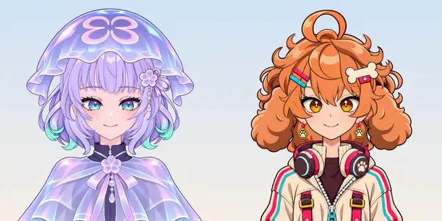
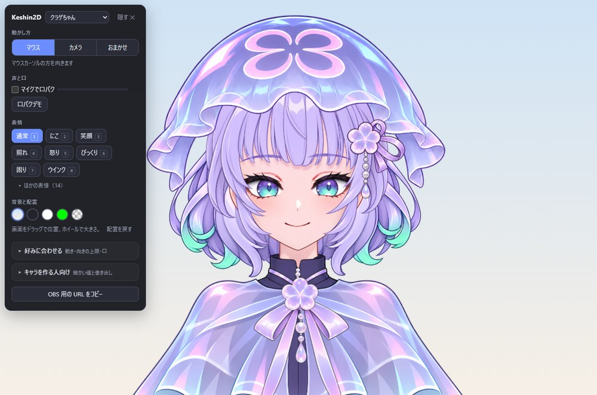
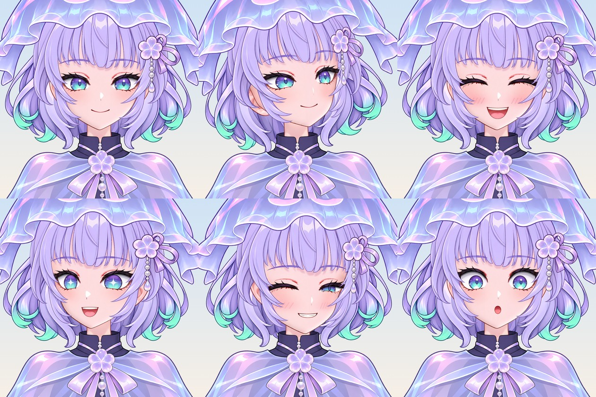
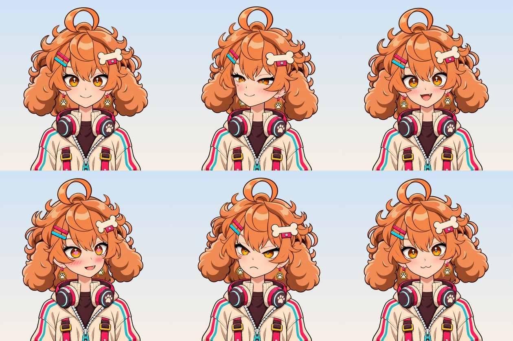
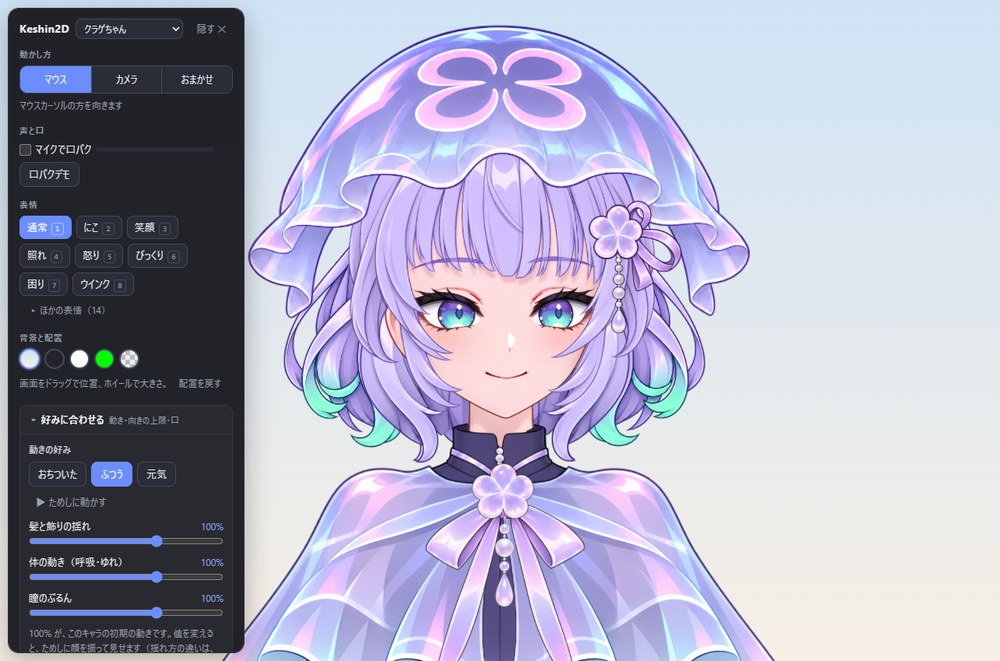

# Keshin2D（化身 2D）

<p align="center"><strong>日本語</strong> | <a href="README.en.md">English</a></p>

<p align="center"><strong>キャラクターの絵を、ブラウザで動かす 2D アバターです。絵 1 枚から、自分のキャラクターのモデルも作れます。</strong></p>
<p align="center"><strong>A 2D avatar that runs in your browser, with tools to build your own model from one character picture.</strong></p>

<p align="center">
  <a href="https://github.com/rotejin/Keshin2D/actions/workflows/ci.yml"></a>
  
  
  
  <a href="https://github.com/sponsors/rotejin"></a>
  <a href="https://x.com/rotejin"></a>
</p>

<p align="center">
  
</p>

パーツに分けた絵を WebGL2 でメッシュ変形して、顔の向き・視線・まばたき・表情・口・髪と飾りの揺れを、毎フレーム描きます。専用のモデリングソフトは要りません。動かすのに要るのは、Python とブラウザだけです。

同梱の「クラゲちゃん」と「チワちゃん」のうち、チワちゃんは、キャラクターの絵 1 枚から、このリポジトリの道具と手順で、最後まで通して作ったモデルです。

**▶ ブラウザで試す: <https://rotejin.github.io/Keshin2D/>**（インストール不要。パネルの上の欄で、2 体を切り替えられます）

## 必要なもの

- **Python 3.8 以上**（標準のライブラリだけで動きます。追加のインストールは要りません。3.10・3.12 で確かめています）
- **WebGL2 が使えるブラウザ**（Google Chrome・Microsoft Edge で確かめています。Firefox・Safari は確かめていません）

自分のキャラクターを作る場合は、さらに次のものが必要です（くわしくは [partsgen/README.md](partsgen/README.md)）。

- Python 3.10 以上（`numpy`・`opencv-python`・`pillow`）、Node.js 22 以上
- **画像生成ができる Codex CLI**（OpenAI。利用には、OpenAI の契約が要ります。Windows の Codex アプリ同梱の物で確かめています）
- Real-ESRGAN（絵の拡大に使います。Vulkan に対応した GPU が要ります。同梱はしていませんが、準備のコマンド 1 つで、配布元から取ってこられます。[partsgen/UPSCALER.md](partsgen/UPSCALER.md)）
- AI のコーディングエージェント（Claude Code など。作業を進めさせます）

## まず同梱のモデルで動かしてみる

このページの **Code → Download ZIP** で取得して展開するか、`git clone` します。そのフォルダの中で、次のどれかで起動します。

| OS | 起動のしかた |
|---|---|
| Windows | `start.bat` をダブルクリック |
| macOS・Linux | ターミナルで `./start.sh`（実行できないときは `sh start.sh`。ZIP で取ると、実行の権限が外れることがあります） |
| どれでも | `python tools/serve.py`（`python3` の環境もあります） |

ブラウザが開いて、クラゲちゃん（`kurage02`）が表示されます。Google Chrome があれば Chrome、無ければ既定のブラウザで開きます。
開いた窓（黒い画面）が、表示用の小さなサーバーです。止めるときは、その窓で Ctrl+C を押すか、窓を閉じます。

- **モデルの切り替え**: パネルのいちばん上の欄で選びます。最初からチワちゃんで開くときは `start.bat --model chiwa`（`./start.sh --model chiwa`）。
- 番号 8770 のポートを使います。使われていれば、空いている番号を探します（最大 20 個先まで）。`--port 番号` でも指定できます。
- `index.html` をダブルクリックして直接開くと、動きません（ブラウザが、ファイルからの読み込みを止めるため）。必ず上の方法で開いてください。



## できること

- **動かし方は 3 つ**: マウス（カーソルの方を向く）・Web カメラ（顔の動きに合わせる）・おまかせ（ひとり芝居）
- **表情 22 個**と、マイクの口パク（声の母音で、口の形も変わります）
- **髪・飾りの揺れ**（房ごとの髪、リボン、ピアス、アホ毛など）を、好みの強さに調整できます
- **OBS** のブラウザソースに、透過で出せます
- **絵 1 枚から、新しいキャラを作れます**（画像生成と、同梱の道具で。[自分のキャラクターを作る](#自分のキャラクターを作る)）
- カメラの映像・マイクの音は、ブラウザの中だけで処理します。外へは送りません

## 同梱のモデル

| クラゲちゃん（`kurage02`） | チワちゃん（`chiwa`） |
| --- | --- |
|  |  |
| 最初に開くモデル。傘（帽子）・髪飾り・胸のリボンが揺れます | アホ毛と、耳のピアスが揺れます |
| `models/kurage02/` | `models/chiwa/` |

`partsgen/chars/` に、2 体の設定（`char.json`）、画像生成への指示文（`prompts/`）、作ったとき・見直したときの記録（`NOTES.md`）も入っています。

チワちゃんは、通す途中で、道具と手順書も直しながら作りました（記録: [partsgen/chars/chiwa/NOTES.md](partsgen/chars/chiwa/NOTES.md)）。

同梱のモデルは、どちらも、プログラムと同じ MIT License です（[ライセンス](#ライセンス)）。

## 画面の操作

左のパネルは、上から 3 つに分かれています。ふだん使うのは、いちばん上だけです。

**ふだんの画面**

| 操作 | 内容 |
|---|---|
| モデル | いちばん上の欄で、モデルを切り替えます（同梱の 2 体と、自分で作ったモデル） |
| 動かし方 | マウス（カーソルの方を向く）・カメラ（Web カメラで、顔の動きに合わせる）・おまかせ（約 14 秒のひとり芝居を、くり返す）。「マウス」を押すと、表情も通常に戻ります |
| マイクで口パク | 声に合わせて口を動かします。声の母音（あいうえお）で口の形も変わります。右に、音の大きさが出ます |
| 口パクデモ | 音を出さずに、話している口を見せます |
| 表情 | 通常を入れて 22 個。よく使う 8 個（通常を含む）は上に並び、数字キー（1〜8）でも切り替えられます。残りは「ほかの表情」の中です |
| 背景 | 明るい色・暗い色・白・緑（クロマキー）・透過 |
| 配置 | 画面をドラッグで位置、ホイールで大きさ、ダブルクリックで元に戻す |
| 隠す | 操作パネルを隠します（H キーでも切り替え）。隠したあとは、マウスを動かすと、左上に、パネルを出すボタン（☰）が出ます |

**好みに合わせる**（押すと開きます）



| 項目 | 内容 |
|---|---|
| 動きの好み | 髪と飾りの揺れ・体の動き（呼吸・ゆれ）・瞳のぷるんを、そのキャラの初期の動きに対する割合（100% が初期）で決めます。「おちついた・ふつう・元気」で、まとめて切り替えられます。値を変えると、ためしに顔を振って見せます |
| 飾りごとに決める | そのキャラに付いている飾り（リボン・鎖・ピアスなど）を、1 つずつ決められます。キャラによって、数と名前が変わります |
| 向きの上限 | 9 方向のボタンを押すと、その向きの上限いっぱいで顔が止まります。止めたまま、左右・上・下・かしげの上限を動かして決めます |
| マイクの口パク | 口パクの大きさ、小さい音を無視、声の高さ。口の形が声と合わないときは「声を覚えさせる」（「あ」から「お」まで、順に案内します） |
| 母音の口の大きさ | 母音を押すと、その口の形で止まります。開き・幅・上下の位置を決められます |

**キャラを作る人向け**: キャラの初期値を決めるための、細かい項目です（手で動かす、顔の動き・髪の揺れのくわしい値、揺れ物ごとの値、瞳の動き、「今の調整値を書き出す」）。ふだん使うだけなら、開かなくてかまいません。

調整した値と配置は、ブラウザに保存されます（モデルごと。ポートの番号が変わると、別の保存になります）。「好みを全部もとに戻す」で、そのキャラの初期値に戻せます。

### OBS で使う

パネルのいちばん下の「OBS 用の URL をコピー」を押すと、今の配置・動かし方と、調整した値を入れた URL ができます。それを、OBS の「ブラウザ」ソースの URL に貼ります（サーバーは起動したままにします）。
調整した値は、ブラウザに保存されるだけなので、OBS（別の保存場所を持ちます）には、この URL で渡します。調整を変えたら、もう一度コピーして貼り直します。

手で書くときの、いちばん短い形は次のとおりです（`model=` は、使うモデルの名前）。

```text
http://127.0.0.1:8770/index.html?model=kurage02&ui=0&bg=transparent
```

`ui=0` で操作パネルを出さず、`bg=transparent` で背景を透過にします。幅と高さは、配信の画面に合わせてください。

**OBS の上での動きは、まだ確かめていません**（マウス追従・Web カメラ・マイクが、OBS のブラウザソースの中で使えるかを含めて）。
うまく動かないときは、ふつうのブラウザで `bg=green`（緑の背景）にして開き、その窓をウィンドウキャプチャして、クロマキーで抜く方法もあります。

### URL の指定

`index.html?` のあとに `&` でつなげて書きます。

| 指定 | 例 | 内容 |
|---|---|---|
| `model` | `model=chiwa` | 開くモデル（`models/` の中のフォルダ名。書かなければ `kurage02`） |
| `hair` | `hair=0` | 髪を出さない（顔の確認用。指定しなければ髪を出す） |
| `ui` | `ui=0` | 操作パネルを出さない |
| `bg` | `bg=transparent` | 背景（`room`・`dark`・`white`・`green`・`transparent`） |
| `mode` | `mode=demo` | 動かし方（`mouse`・`camera`・`demo` = おまかせ） |
| `exp` | `exp=笑顔` | 表情。指定すると、その表情で止めて表示します |
| `yaw`・`pitch`・`roll` | `yaw=20` | 顔の左右・上下・かしげ（度）。指定すると、その向きで止めて表示します |
| `cx`・`cy`・`zoom` | `zoom=2&cy=800` | 表示の中心と大きさ（指定すると、保存した配置を使いません） |

ほかに、「キャラを作る人向け」のスライダーの項目も、名前で指定できます（例: `yawMax=25`。名前は `js/avatar.js` の `PARAMS`・`TUNE`）。調整した値をまとめて渡す `set=` は、「OBS 用の URL をコピー」が作ります。

## 自分のキャラクターを作る

キャラクターの絵 1 枚から、画像生成（Codex CLI）で、パーツを清書した絵を描かせ、同梱の道具で切り出し・配置して、モデルを書き出します。

1. **準備する**
   [partsgen/README.md](partsgen/README.md) の「準備」のとおりに、Python の環境・Real-ESRGAN・Codex CLI をそろえます（そろったかは、コマンド 1 つで確かめられます）。
2. **AI に、絵の場所と名前を渡す**
   AI のコーディングエージェント（Claude Code など）を、このフォルダで開きます。[partsgen/MASTER_PROMPT.md](partsgen/MASTER_PROMPT.md) の指示文を貼り、**キャラクターの絵の場所と、付けたい名前（英数字）の 2 行だけ**を書き換えて渡します。
3. **止まる所で、見て決める**
   基準の絵が、そのキャラに見えるか。髪のデザインの案。動かしたときの感触。この 3 か所で、エージェントが止まって確かめます。あとは、エージェントが進めます。

できたモデルは `models/<名前>/` に入り、パネルのいちばん上の欄か、`start.bat --model <名前>` で開けます。

- **指示 1 つで、いつも同じ質の物ができる、という所までは、まだ確かめていません。** これまでのキャラは、どれも、途中で道具と手順書を直しながら通しました。つまずいた所と直し方は、手順書に入れてありますが、直したあとの手順書だけで、新しいキャラを最初から通し直したことは、まだありません（確かめてある範囲は、`partsgen/MASTER_PROMPT.md` の冒頭）。
- 生成結果は毎回異なるため、仕上がりには差が出ます。AI が確認できるのは、止めたコマだけなので、動きの感触は、実際に動かして確かめてください。気になった所は、感じたままの言葉で伝えれば足ります（「紙のようにぺらぺらしている」「耳に通っていない感じがする」など）。
- 道具は Windows で作り、確かめています。ほかの OS では確かめていません。Windows のユーザー名が日本語の PC でも使えます。
- 渡す絵は、自分が使ってよい絵にしてください。

同梱のチワちゃんを作ったときに、見たこと・決めた値・つまずいた所は、[partsgen/chars/chiwa/NOTES.md](partsgen/chars/chiwa/NOTES.md) に残してあります。

## ドキュメント

| 目的 | 読むもの |
| --- | --- |
| 自分のキャラクターを作る（要るもの・準備・流れ） | [partsgen/README.md](partsgen/README.md) |
| エージェントに渡す指示文 | [partsgen/MASTER_PROMPT.md](partsgen/MASTER_PROMPT.md) |
| 手順の全部（段階 0〜8、設定の項目、章ごとの落とし穴） | [partsgen/WORKFLOW.md](partsgen/WORKFLOW.md) |
| 品質の基準、確かめ方、失敗と直し方 | [partsgen/KNOWHOW.md](partsgen/KNOWHOW.md) |
| 絵 1 枚から通して作った例（チワちゃん） | [partsgen/chars/chiwa/NOTES.md](partsgen/chars/chiwa/NOTES.md) |
| コーディング AI 向けの作業の決まり | [AGENTS.md](AGENTS.md) |
| 変更の履歴 | [CHANGELOG.md](CHANGELOG.md) |
| 開発に参加する | [CONTRIBUTING.md](.github/CONTRIBUTING.md) |
| 使わせてもらっている物と、そのライセンス | [THIRD_PARTY_NOTICES.md](THIRD_PARTY_NOTICES.md) |

フォルダの構成:

| 場所 | 内容 |
|---|---|
| `index.html`、`js/avatar.js` | ビューアとエンジン |
| `js/keyshape.js` | 目と口を、描いた絵（キーの形）の変形で動かす |
| `js/lipsync.js` | マイクの口パク（音の大きさと母音） |
| `models/<名前>/` | モデル（`model.json` と `parts/*.png`）。同梱は `kurage02` と `chiwa` |
| `models/index.json` | パネルの「モデルを選ぶ欄」に出すモデルの一覧（`tools/serve.py` で開くと、自分で作ったモデルも自動で足されます） |
| `tools/serve.py` | 表示用のサーバー（`start.bat`・`start.sh` が使う） |
| `tools/check_repo.py` | リポジトリの中身が、そろっているかの検査 |
| `vendor/mediapipe/` | Web カメラの顔の追跡（MediaPipe Tasks Vision 0.10.14 と Face Landmarker のモデル。`SHASUMS256.txt` に、取ってきたときのチェックサム） |
| `partsgen/` | 新しいキャラを作る道具と手順書。`partsgen/chars/` に、同梱の 2 体の設定・指示文・記録 |
| `docs/images/` | この説明に使っている絵 |

サーバーを使わずに、ファイルを置くだけの場所（GitHub Pages など）でも動きます。その場合、モデルを選ぶ欄に出るのは、`models/index.json` に書いたモデルです。

## 困ったときは

### ZIP から起動すると Windows の警告が出る

インターネットから入手したファイルなので、`start.bat` を開くときに、「Windows によって PC が保護されました」などの警告が出ることがあります。ZIP を展開する前に、ZIP を右クリック → **プロパティ** → 下にある **許可する** にチェック → **OK** としてから展開すると、この警告は出なくなります。

### 「Python 3.8 or later was not found.」と出る

Python が入っていないか、古い版です。<https://www.python.org/downloads/> から入れて、もう一度 `start.bat` を開いてください。

### 何も表示されない・「画像を読み込み中…」のまま

- `index.html` を直接開いていないかを確かめてください（アドレスが `file:///` で始まっていたら、直接開いています）。`start.bat`・`start.sh`・`python tools/serve.py` で開きます。
- 黒い画面（サーバー）を閉じると、表示できなくなります。開いたままにしてください。
- パネルの「動かし方」の下に「WebGL2 が使えません」と出たら、ブラウザが対応していません。Google Chrome か Microsoft Edge で開いてください。

### カメラで動かない

「カメラ」を押すと、ブラウザが、カメラを使う許可を求めます。許可しなかったときは、アドレスバーの左のアイコンから、カメラを許可し直してください。パネルの「動かし方」の下に「カメラを開始できませんでした」と出たときは、ほかのアプリがカメラを使っていないかも確かめてください。

### マイクで口が動かない

「マイクで口パク」を入れると、ブラウザが、マイクを使う許可を求めます。右の棒（音の大きさ）が動いているのに、口の動きが小さいときは、「好みに合わせる」→「マイクの口パク」で、大きさを上げます。口の形が声と合わないときは、同じ所の「声を覚えさせる」を使います。

### 動きがおかしくなった・調整を元に戻したい

「好みに合わせる」のいちばん下の「好みを全部もとに戻す」で、そのキャラの初期値に戻ります。位置と大きさは、画面をダブルクリックすると戻ります。

### 作ったモデルが、欄に出ない

- `models/<名前>/model.json` があるかを確かめてください。
- `start.bat`・`start.sh`・`python tools/serve.py` で開いていれば、自動で出ます。ファイルを置くだけの場所（GitHub Pages など）では、`models/index.json` に、名前を 1 行足します。

## 新しい版にする

**git で入手した場合**: サーバー（黒い画面）を止める → `git pull` → `start.bat` を開く。

**ZIP で入手した場合**: 新しい ZIP を別のフォルダに展開し、古いフォルダから、自分で作ったモデル（`models/<名前>/`）と、その設定（`partsgen/chars/<名前>/`）を、同じ場所へコピーします。

調整した値は、ブラウザに保存されているので、そのまま使われます。インストールしている物は無いので、やめるときは、フォルダごと削除します（調整した値は、ブラウザの「サイトのデータ」を消すと消えます）。

## 質問・不具合の報告

[Issue](https://github.com/rotejin/Keshin2D/issues/new/choose) から、テンプレートを選んで書いてください。書いてほしいことは [SUPPORT.md](.github/SUPPORT.md) にあります。脆弱性は公開の Issue に書かず、[SECURITY.md](.github/SECURITY.md) の方法で報告してください。

そのほかの作者への連絡は、X（[@rotejin](https://x.com/rotejin)）へどうぞ。

## プライバシー

- **Web カメラ**: 顔の追跡に MediaPipe（Google）を使います。同梱してあるので（`vendor/mediapipe/`）、インターネットにつながっていなくても使えます。カメラの映像は、ブラウザの中だけで使い、録画も送信もしません。
- **マイク**: ブラウザの中で、音の大きさと母音を調べるだけです。録音も送信もしません。
- ビューアは、外へ通信しません。調整した値と配置は、手元のブラウザに保存します。

## 分かっている課題

- チワちゃんは、斜め下いっぱいを向くと、奥の目が、顔の輪郭を少しまたぎます（髪があると、輪郭の所で切れて見えます）。
- クラゲちゃんは、斜め上を向くと、手前の耳が、大きく見えます。
- Web カメラの追跡と、マイクの口パクは、テスト用の映像と音で動くことまでは確かめています。実際の顔と声での当たり具合は、まだ十分に確かめていません。
- モデルごとの、直していない所・確かめていない所は、`partsgen/chars/<名前>/NOTES.md` の終わりの方に書いてあります。

## 名前について

「化身（けしん）」は、英語の avatar（アバター）の、もとの意味の訳語です。Keshin2D は、Live2D 社の製品ではありません。Live2D のモデルは、読み込めません（モデルは、このリポジトリの形式の `model.json` と、パーツの PNG です）。また、OpenAI・Anthropic・Google の公式ツールではありません。

## ライセンス

- [MIT License](LICENSE)。プログラム（`js/`・`tools/`・`partsgen/` ほか）も、同梱のモデル `kurage02`・`chiwa`（`models/` の絵と `model.json`）と `docs/images/` の絵も、同じ MIT です（`vendor/mediapipe/` に同梱した MediaPipe だけは、Apache License 2.0）。同梱のモデルを、自分のアバターとして使う・改変する・配信や営利に使うことも、MIT の条件（著作権表示とライセンス文を残す）で自由です。
- 使わせてもらっている物と、そのライセンス: [THIRD_PARTY_NOTICES.md](THIRD_PARTY_NOTICES.md)

自分の絵から作ったキャラクターは、あなたのものです（元の絵の権利と、画像生成サービスの規約に従ってください）。

## English

The full English guide is in [README.en.md](README.en.md).
